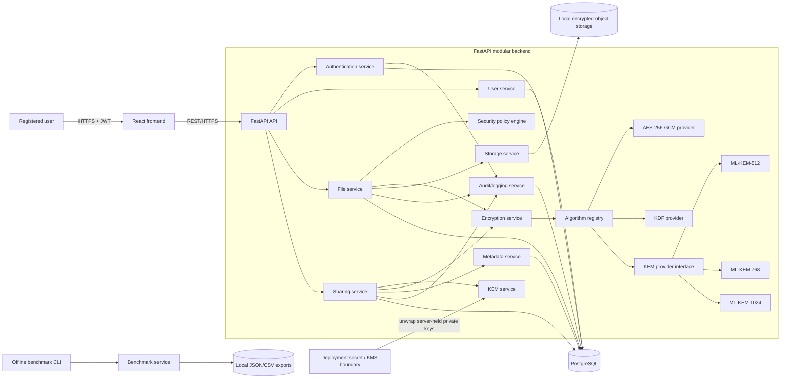
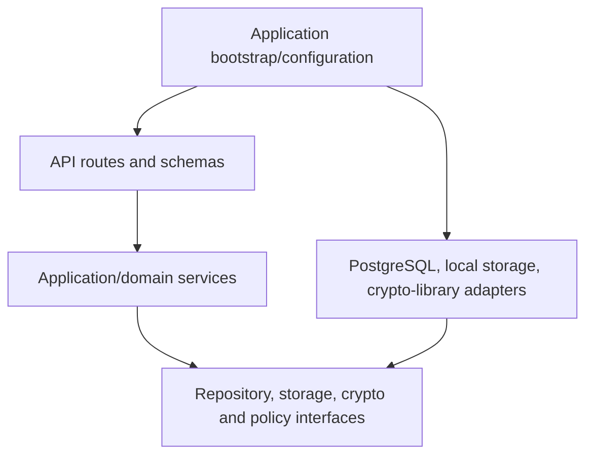
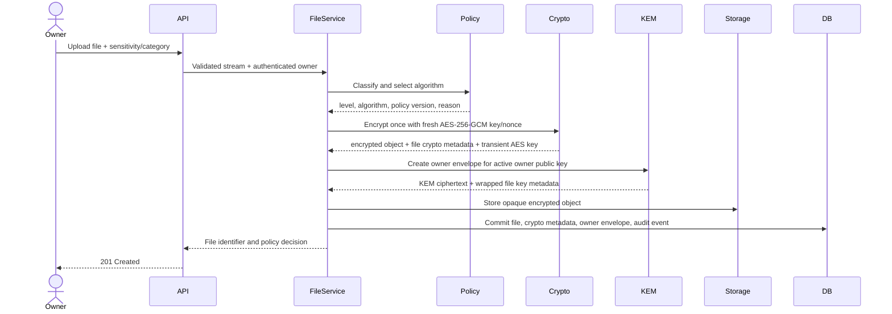
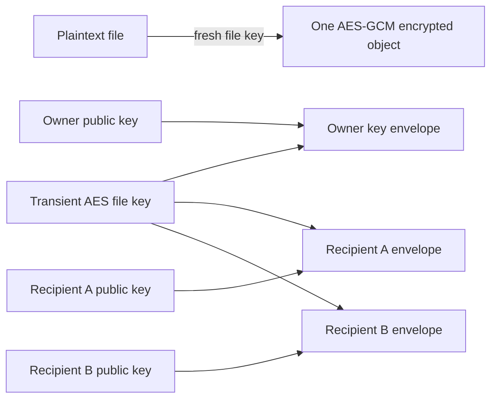
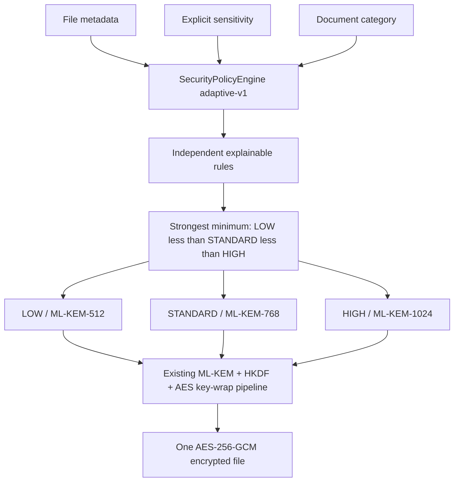
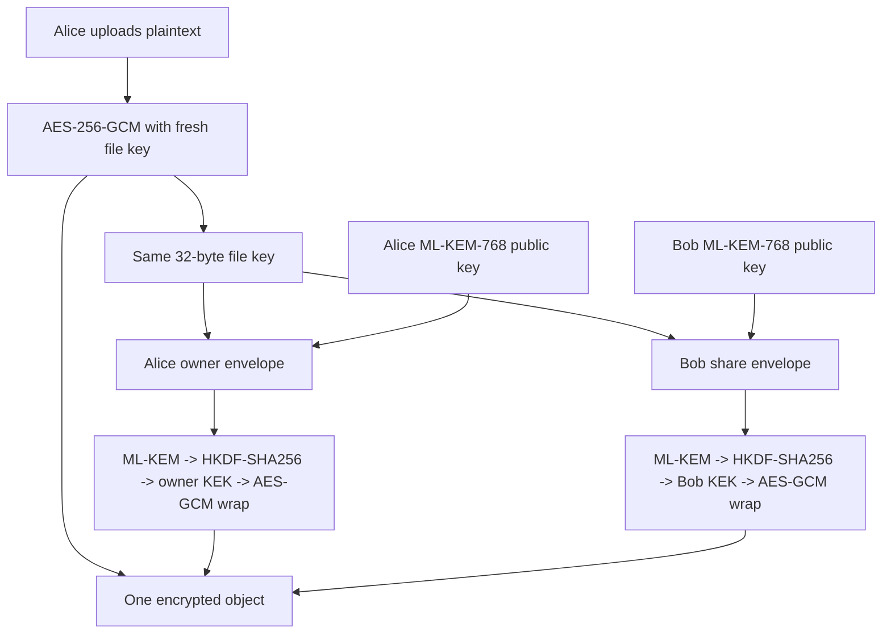

# Architecture

## Final implemented boundary (Phase 17)

The current modular monolith is React/Vite → FastAPI → authorization, file/share/policy/signature services → six allow-listed PQ_ONLY/HYBRID crypto suites → PostgreSQL metadata and one encrypted local object per file. Offline benchmark/experiment CLIs export local JSON/CSV; authenticated research views read completed exports. The backend manages user private keys protected by an application master key and is inside the confidentiality trust boundary. It is **not** zero-knowledge or client-held end-to-end encryption. Revocation denies future application retrieval, not previously downloaded plaintext. See [FINAL_REPORT.md](FINAL_REPORT.md) and [RESULTS_SUMMARY.md](RESULTS_SUMMARY.md). All numbered phase sections below are historical implementation snapshots; use the current code and OpenAPI for exact behavior.

## Phase 14 experimental boundary

The offline `AdaptiveExperimentService` pairs the production `SecurityPolicyEngine` AUTO decision with a Fixed-HIGH suite lookup through the same `CryptoSuiteRegistry`, using Phase 13 providers and a required Phase 13 result export as method/environment reference. Deterministic synthetic files, paired recipient contexts, alternating order, correctness checks, and raw/aggregate exports are isolated from production routes and database state. The React benchmark page only imports local completed experiment JSON. Neither the synthetic crypto-only nor local-transfer track is presented as HTTP/database latency. See [Adaptive evaluation](ADAPTIVE_EVALUATION.md).

## Phase 13 offline measurement boundary

`app.benchmarks.BenchmarkService` is separate from production file/share services. It composes the existing provider and suite interfaces for synthetic primitive, envelope, file, sharing, and local-transfer measurements, plus a benchmark-only X25519 baseline. The CLI exports JSON/CSV; the React benchmark page reads a user-selected local JSON export. No benchmark-run HTTP endpoint or benchmark database table is deployed. The synthetic transfer excludes application HTTP/auth/DB latency. See [Benchmarking](BENCHMARKING.md).

## Phase 12 share lifecycle

`ShareService` owns the ACTIVE→REVOKED transition. A conditional database update, recipient-envelope disablement, and secret-free audit event commit together; a revoked recipient is rejected before signature or key operations. Historical shares and signed creation snapshots remain visible, while a new share uses a new recipient envelope and signature. File deletion still cascades live grants but retains a `FILE_DELETED` audit event. See [Access revocation](ACCESS_REVOCATION.md). Earlier sections are historical phase snapshots.

## Phase 11 authenticity boundary

`SignatureService` and the separate ML-DSA profile registry sit beside, not inside, the six confidentiality `CryptoSuite` mappings. `FileService` signs after encryption and before committing a new file; `ShareService` signs the recipient-bound share package before committing. Both downloads verify the actual ciphertext and exact historical signing key before any key recovery. The React client displays fresh verification results but cannot bypass backend enforcement. See [Digital signatures](DIGITAL_SIGNATURES.md). Earlier phase sections below are historical.

## Phase 10 hybrid architecture

The backend now supports optional hybrid X25519 + ML-KEM file-key protection. `SecurityPolicyEngine` still decides only LOW/STANDARD/HIGH, while the approved suite mapping selects by explicit architecture and level. `HybridKeyProtector` uses a `KeyAgreementProvider` plus the stored suite's KEM/KDF/wrap providers; `FileService` and `ShareService` orchestrate versioned owner/share metadata without implementing primitive arithmetic. See [Hybrid cryptography](HYBRID_CRYPTO.md). Older phase descriptions below are historical and do not describe the current full capability set.

## Phase 9 crypto-suite boundary

Policy produces a trusted security level and suite ID. The suite registry resolves that ID to injected AEAD, KEM, KDF, and key-wrap providers; encryption orchestration invokes those roles. File and sharing services never import native cryptographic library classes. Stored suite/version metadata, not current defaults, selects the historical decrypt path. See `CRYPTO_AGILITY.md` for the diagram, lifecycle rules, and extension procedure.

## 1. Architectural style

QuantumShield begins as a modular monolith: one React client, one FastAPI backend divided into focused modules, PostgreSQL for structured data, and a replaceable object-storage adapter. This keeps a college project deployable while preserving interfaces that can later be split or replaced. Internal services are Python modules/classes called through explicit interfaces, not network microservices.

The first implementation is server-mediated and server-managed: TLS protects the client connection; authenticated backend code performs encryption/decryption and controls user private keys. Consequently, the backend is inside the confidentiality trust boundary and the first version is not zero-knowledge or end-to-end encrypted.

**Current implementation boundary:** Phase 8 implements authentication, owner
authorization, AES-256-GCM encrypted objects, per-user ML-KEM-512/768/1024
keysets, explicit LOW/STANDARD/HIGH selection, master-key-protected private
material, HKDF-SHA256, version-2 owner envelopes, and recipient-bound sharing
envelopes. A separate deterministic `SecurityPolicyEngine` provides
MANUAL/RECOMMEND/AUTO selection with versioned reasons and enforced minimums.
Phase 4 version-1 files remain readable. This paragraph is a historical Phase 8 snapshot; later sections above describe Phase 11 signatures, Phase 12 revocation, and Phase 13 benchmarking. Key rotation remains future work.

## 2. System context



The production deployment substitutes an object store for local storage and a KMS/secret manager for local secret configuration without changing domain services.

## 3. Component responsibilities

| Component | Owns | Must not own |
| --- | --- | --- |
| React frontend | Forms, navigation, safe file transfer, displaying policy recommendations and errors | Authorization decisions, secret keys in the server-managed version, or cryptographic policy enforcement |
| API/routes | HTTP parsing, schema validation, authentication dependency, response mapping | Persistence queries or direct cryptographic calls |
| Authentication service | Registration, password verification, token issue/refresh/revocation strategy | File authorization or key encapsulation |
| User service | Profiles, unique identity lookup, user-state rules | Password verification details or file encryption |
| File service | Upload lifecycle, ownership checks, policy request, AES encryption orchestration, file metadata | ML-KEM implementation details or raw filesystem paths from users |
| Encryption service | AES-GCM operations, file-key wrapping/unwrapping orchestration, canonical AAD | HTTP, database sessions, or user authorization |
| KEM service | User key lifecycle; provider selection; encapsulate/decapsulate calls | File storage or access-control decisions |
| Security policy engine | Classification, minimum policy, configurable label-to-algorithm mapping, reason codes | Claiming security beyond configured rules or selecting unsupported providers |
| Sharing service | Owner checks, recipient/key resolution, recipient envelope creation, revocation state | Direct file byte encryption or frontend trust |
| Storage service | Opaque object put/get/delete, generated object keys, streaming, integrity-neutral storage behavior | Interpreting plaintext names, access policy, or key custody |
| Metadata service | Versioned crypto metadata and recipient envelopes; consistent lookup | Decrypting secrets |
| Benchmark service | Controlled measurement, environment capture, aggregate results | Production access decisions or leaking key material into results |
| Audit/logging service | Structured security events, actor/resource/action/outcome/reason/correlation ID | Secrets, tokens, plaintext, or sensitive raw payloads |
| Repositories | Typed persistence operations and transaction boundaries | Business policy or cryptography |
| PostgreSQL | Identities, permissions, metadata, encrypted private-key blobs, audit records | Plaintext passwords, AES keys, ML-KEM shared secrets, plaintext files, or Phase 13 benchmark exports |

## 4. Dependency direction



Domain services depend on interfaces (`ports`), and concrete adapters implement them. The application bootstrap composes concrete objects. This prevents framework, database, storage, and library details from spreading through the domain.

## 5. Primary data flow

### Upload and first key envelope

An upload is useful only if an authorized principal can later recover its file key. The recommended first implementation creates an **owner envelope** during upload using the owner's active public key. Later shares add recipient envelopes without re-encrypting the file.



Implementation must define a recoverable state machine because object storage and PostgreSQL do not share one transaction. A safe pattern is `PENDING_UPLOAD -> ACTIVE`, using a temporary/generated object key, database transaction, finalization, and idempotent cleanup of stale pending/orphan objects. Exact sequencing is a Phase 3/4 decision and must be failure-tested.

### Add a recipient

To share an existing file, the trusted backend authorizes the owner, recovers the AES file key through the owner's envelope, encapsulates to the recipient's active public key, derives a new KEK, wraps the same AES key, immediately discards transient secrets where practical, and commits a new `FileShare` plus `FileKeyEnvelope`. The encrypted file bytes are unchanged.

### Authorized download

The backend authenticates the caller, verifies an active owner/recipient grant, selects that principal's envelope and referenced private-key version, decapsulates, derives the KEK, unwraps the AES file key, authenticates/decrypts the encrypted object, and releases the plaintext only after successful authentication. For large streaming formats, plaintext must be buffered/quarantined until the authenticated result is known or use a reviewed chunked AEAD design; unauthenticated partial output is forbidden.

## 6. Multi-recipient model



Each envelope contains its own KEM ciphertext, wrapping nonce, wrapped AES key plus authentication tag, algorithm IDs, recipient key version, KDF context/version, and envelope version. A share references exactly one active envelope. A new recipient costs a small envelope, not a duplicate encrypted file.

## 7. Adaptive security decision

The deterministic policy engine evaluates normalized inputs:

1. Deployment/organization minimum and allowed algorithms.
2. Explicit user sensitivity (`LOW`, `STANDARD`, `HIGH`).
3. Category/file-type rules and optional keyword classifier output.
4. Optional size/performance constraints, which may inform a recommendation but cannot override a security minimum.
5. Provider availability and approved implementation status.

The implemented Phase 8 engine returns the minimum, recommendation, selected level, KEM algorithm, policy version, rule results, readable reasons, and override state. It uses LOW -> ML-KEM-512, STANDARD -> ML-KEM-768, and HIGH -> ML-KEM-1024. Metadata rules are independent and the explicit numeric ordering selects their strongest minimum. Unknown inputs and contradictory modes fail closed. The selected algorithm remains fixed for the envelope; later policy changes do not silently reinterpret existing metadata.



## 8. Proposed backend structure

```text
backend/
  pyproject.toml
  app/
    main.py                 # FastAPI construction and lifespan only
    api/
      dependencies.py       # auth/session/service dependencies
      routes/               # auth, users, files, shares, crypto, benchmarks, health
    core/
      config.py             # validated environment configuration
      errors.py             # domain-to-HTTP error mapping
      security.py           # password/JWT helpers (not file crypto)
    models/                 # ORM persistence models
    schemas/                # API request/response models
    services/               # application use cases by bounded responsibility
    crypto/
      base.py               # provider protocols and typed results
      registry.py           # allow-listed algorithm/version lookup
      aes.py                # AES-GCM adapter
      kdf.py                # reviewed KDF adapter/context encoding
      envelope.py           # versioned envelope/AAD representation
      kem/                  # ML-KEM provider adapters; future hybrid adapter
      signatures.py          # ML-DSA provider boundary
    repositories/           # repository interfaces and PostgreSQL adapters
    storage/                # storage interface and local adapter
    policy/                 # classification rules and versioned mappings
    db/                     # engine/session/migrations wiring
    audit/                  # redaction and structured event definitions
  tests/
    unit/
    integration/
    security/
    vectors/
```

Folders are introduced only when their phase begins; this tree is a target, not a Phase 0 scaffold. `services` orchestrate use cases, while `crypto` performs cryptographic transformations and returns typed data. Route functions remain thin.

## 9. Proposed frontend structure

```text
frontend/
  src/
    app/                    # router and application composition
    components/             # reusable presentational components
    pages/                  # Login, Register, Dashboard, Upload, My Files,
                            # Shared With Me, Share, Security Settings, Benchmarks
    services/               # typed REST client modules
    hooks/                  # reusable UI/data hooks
    context/                # narrow auth/session context if needed
    utils/                  # formatting and client validation
    types/                  # shared frontend-only types
    test/                   # test setup and helpers
```

The frontend may improve usability but is not a security boundary. It never determines whether access is allowed.

## 10. Storage architecture

`StorageService` exposes opaque operations such as `put(stream, object_key)`, `get(object_key)`, `delete(object_key)`, and `exists(object_key)`. Domain-generated UUID-based keys—not user filenames—address objects. The database keeps the user-facing original filename separately and treats it as untrusted display data. Local storage resolves and verifies paths beneath one configured root and rejects traversal. The interface must accommodate streaming and object-store metadata without exposing provider-specific URLs to clients by default.

## 11. Configuration and secret boundary

Non-secret configuration includes database host, upload limits, allowed algorithms, default policy version, storage adapter, token lifetimes, and feature flags. Secrets include database password, JWT signing key/private key, server master KEK or KMS credentials, and cloud credentials. Secrets never enter source control, logs, benchmark records, or API responses. Development may use a local untracked environment file; production should use a managed secret store/KMS.

## 12. Reliability and concurrency

- Database uniqueness constraints, not pre-checks alone, enforce unique email and one active share/envelope per relevant tuple.
- Share/revoke operations lock or atomically update the targeted grant to prevent double-active records.
- Key activation is transactional so at most one current key per user/algorithm policy is selected.
- Upload and deletion use explicit states and idempotency to handle retries.
- Revocation is checked at metadata retrieval and immediately before plaintext release to reduce race windows; it cannot undo material already delivered.
- Unknown metadata or provider versions fail closed and remain diagnosable through secret-free audit reason codes.

## 13. Future extension points

- `KEMProvider`: ML-KEM parameter sets and later hybrid strategy.
- `KDFProvider`: versioned, context-bound derivation.
- `SignatureProvider`: later ML-DSA signing/verification of canonical manifests.
- `StorageService`: local filesystem to cloud/object storage.
- `SecurityPolicyEngine`: rules now, optionally evaluated classifier later with a policy floor.
- `BenchmarkAdapter`: classical baseline, KEM variants, and hybrid measurement under the same harness.

No extension point permits arbitrary client-supplied algorithm names; the server chooses from an allow-listed registry.

## 14. Key provisioning compatibility

An envelope can be created only when its recipient already has an active public key for the selected KEM algorithm. In the initial server-managed design, account/key setup should provision active keys for every currently enabled parameter set once Phase 7 is reached, or use an explicit authenticated provisioning workflow before the user can receive that class of share. The sharing service must not silently create or replace another user's key as a side effect. If a compatible key is missing, sharing fails safely with a setup-required result. Adding a new algorithm later requires an explicit rollout/migration plan for existing users.

## 15. Benchmark architecture

`BenchmarkService` runs only allow-listed scenarios using synthetic data and production provider interfaces. The offline CLI separates setup, warm-up, repeated measurement, aggregation, and JSON/CSV export; no database persistence or remote-run API is deployed. Primitive measurements include key generation, encapsulation, decapsulation, AES encryption, and AES decryption. `END_TO_END` is explicitly a synthetic local transfer, not production HTTP/database request latency. Artifact measurements include public/private key sizes, KEM ciphertext size, encrypted-file/recipient-envelope overhead, and peak Python allocation for one untimed protect call.

Each run records scenario/configuration, provider versions, policy scenario, file size, iterations, sanitized OS/runtime details, units, clock source, and summary statistics. A benchmark-only `BENCH-X25519-V1` baseline is defined; it cannot be selected for production sharing. Phase 14 must use matched workloads and environments for full adaptive-versus-fixed analysis. Production user content and generated secrets are never stored in benchmark exports. See [Benchmarking](BENCHMARKING.md).

## Phase 15 presentation architecture

Phase 15 presentation uses a single owner-scoped dashboard aggregate for counts, distributions, key readiness, recent owner decisions, and relevant audit events. Local research exports are exposed through authenticated read-only endpoints with fixed filenames and UUID run-directory constraints. Frontend bars/tables are display-only; cryptography, policy, authorization, and verification remain backend-owned. See [UI dashboard](UI_DASHBOARD.md).

## 16. Technology decisions to validate in Phase 1+

- Select maintained Python packages with exact ML-KEM parameter-set support and test-vector compatibility.
- Select PostgreSQL/ORM/migration versions and asynchronous versus synchronous request model.
- Decide token renewal/revocation design and whether cookies or bearer storage best fit the deployed frontend threat model.
- Select a vetted large-file AEAD/framing approach before implementing streaming downloads.
- Define server master-key/KMS development and production handling.
- Record exact classical baseline (for example an approved X25519-based envelope) before benchmarking; do not label unlike protocols as equivalent without explaining the comparison.

## 17. Phase 6 single-ciphertext architecture



`FileService` owns the encrypted-object lifecycle and can recover only the owner's file key. `ShareService` derives the sender from authentication, validates ownership and recipient readiness, generates the recipient envelope, and commits `FileShare` plus `ShareCryptoMetadata` atomically. `ShareRepository` scopes sent/received/detail queries. Recipient download loads the exact historical key ID, recovers the share envelope, then calls the common content-decryption path. Sharing never invokes storage read/write; the one encrypted object is unchanged.

