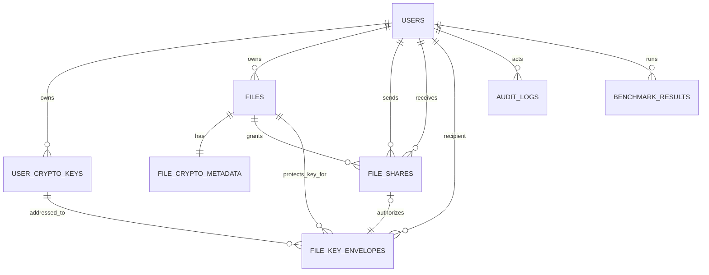

# Database Design

## Current implementation note (Phase 17)

The current SQLAlchemy/Alembic schema has eight tables: `users`, `user_crypto_keys`, `files`, `file_crypto_metadata`, `file_shares`, `share_crypto_metadata`, `digital_signatures`, and `audit_logs`. Owner key envelopes are fields of `file_crypto_metadata`; recipient envelopes are fields of `share_crypto_metadata`. The early `file_key_envelopes` and `benchmark_results` tables in the **historical proposal below are not deployed**. Offline benchmark and adaptive results are local JSON/CSV exports under `backend/benchmark_results/`, not database records. Actual columns, constraints, and migration history are in `backend/app/models/` and `backend/alembic/versions/`. The earlier ER/entity sketch is retained only as a record of design evolution; see [FINAL_REPORT.md](FINAL_REPORT.md) for the implemented relationship view.

## Phase 12 lifecycle schema

Migration `0011_share_revocation` retains `file_shares.status` and expands its constraint to ACTIVE/REVOKED. It adds `revoked_at`, `revoked_by_user_id`, optional bounded `revoke_reason`, and `share_crypto_metadata.is_active`. A partial unique index permits at most one ACTIVE grant per file/recipient while preserving revoked history. `audit_logs` retains secret-free creation, revocation, denied-download, and file-deletion events even after file/share cascade deletion. Existing rows default ACTIVE and active envelope state; downgrade refuses to discard lifecycle/audit history. See [Access revocation](ACCESS_REVOCATION.md).

## Phase 11 signature schema

Migration `0010_digital_signatures` adds `user_crypto_keys.key_purpose` (backfilled `KEM`/`KEY_AGREEMENT`), the three ML-DSA algorithm allow-list/length checks, `files.signature_required`, `file_shares.signature_required`, and `digital_signatures`. The latter stores FILE/SHARE scope, signer, exact key ID/version, profile/algorithm/payload version, signature, ciphertext SHA-256, key-package SHA-256, and file/share foreign keys. Partial unique indexes enforce one FILE signature per file and one SHARE signature per share. New flags are true; historical rows backfill false and are not signed retroactively. Downgrade refuses if signed data or signing keys exist. See [Digital signatures](DIGITAL_SIGNATURES.md).

## Phase 10 hybrid schema

Migration `0009_hybrid_envelopes` permits `X25519` in `user_crypto_keys` with 32-byte raw public keys and 48-byte AES-GCM-protected private key blobs. File and share crypto metadata gain `security_architecture`, `classical_algorithm`, `ephemeral_public_key`, `recipient_classical_key_id`/`version`, and `combiner_version`. Exact suite-level/KEM constraints now permit six approved suites; version/architecture constraints require complete hybrid fields only for file version 4 or share version 3. Existing rows receive `PQ_ONLY` and keep their exact bytes and versions. Downgrade is refused if X25519 or hybrid rows remain. No raw shared secrets, KEKs, or ephemeral private keys are stored. See [Hybrid cryptography](HYBRID_CRYPTO.md).

## Phase 9 suite metadata

Migration `0008_crypto_suites` adds nullable `crypto_suite_id`/`crypto_suite_version` to `file_crypto_metadata` (legacy version 1 remains null) and required equivalents to `share_crypto_metadata`. It backfills unambiguous ML-KEM-512/768/1024 rows to their approved V1 suites without changing `crypto_version`. Check constraints bind suite, level, AEAD, KEM, KDF, and key-wrap identifiers; application registry validation remains the authoritative fail-closed check.

## 1. Historical design goals and proposed schema

PostgreSQL stores identity, authorization, versioned cryptographic metadata, and audit/benchmark records. It does not store plaintext files, plaintext passwords, raw AES file keys, ML-KEM shared secrets, or derived KEKs. Encrypted file objects live behind `StorageService`; the database holds opaque object keys.

Use UUIDs generated by the application or database for external identifiers, timezone-aware UTC timestamps, explicit foreign keys, database uniqueness/check constraints, and migrations. Exact SQLAlchemy types and migration tooling are Phase 1 decisions.

## 2. Relationship model

An owner envelope has `file_share_id = NULL`, `recipient_user_id = files.owner_id`, and `grant_type = OWNER`. A shared-recipient envelope has `grant_type = SHARE` and a one-to-one reference to its `FileShare`. This makes every key-access artifact recipient-specific.

## 3. Entities

### `users`

| Field | Purpose / constraints | Sensitivity |
| --- | --- | --- |
| `id` UUID PK | Stable user identifier | Internal |
| `name` varchar | Validated display name | Personal data |
| `email_normalized` varchar unique | Case/normalization policy applied consistently | Personal/sensitive |
| `password_hash` text | Encoded Argon2id/bcrypt output including parameters/salt | Sensitive; never return |
| `status` enum | `ACTIVE`, `DISABLED`, `PENDING` as needed | Internal |
| `created_at`, `updated_at` timestamptz | Lifecycle | Internal |
| `password_changed_at` timestamptz | Token/session invalidation support | Internal |

Do not store plaintext passwords, password hints, or recoverable password encryption.

### `user_crypto_keys` — Phase 7 implemented schema

| Field | Purpose / constraints | Sensitivity |
| --- | --- | --- |
| `id` UUID PK | Key-version identity | Internal |
| `user_id` UUID FK | Key owner | Sensitive relationship |
| `algorithm` varchar | Stable allow-listed ID: `ML-KEM-512`, `ML-KEM-768`, or `ML-KEM-1024` | Public metadata |
| `public_key` bytea | Encoded public key | Public material; integrity required |
| `encrypted_private_key` bytea | AES-GCM ciphertext/tag of algorithm-specific private material | Critical encrypted material |
| `private_key_nonce` bytea length 12 | Non-secret protection nonce | Security metadata |
| `private_key_protection_algorithm` varchar | `MASTER-AES-256-GCM` | Security metadata |
| `private_key_protection_version` smallint | Private-key AAD/profile version | Security metadata |
| `key_version` smallint >= 1 | Version referenced by file metadata | Security-critical |
| `is_active` boolean | Initial-key selection state | Internal |
| `created_at`, `revoked_at` | Lifecycle; rotation is future work | Internal |

Phase 7 creates one active version for each supported ML-KEM algorithm during registration. The tuple `(user_id, algorithm, key_version)` is unique, and an index supports exact active-key lookup. Public bytes can be returned only by authenticated key endpoints; private fields never appear in API schemas.

### `files` — implemented schema

| Field | Purpose / constraints | Sensitivity |
| --- | --- | --- |
| `id` UUID PK | External file identifier | Internal/unguessable, not an authorization secret |
| `owner_id` UUID FK | Owner | Sensitive relationship |
| `original_filename` text | Validated display-only name, not a path | Sensitive metadata |
| `stored_filename` varchar unique | Server-generated UUID filename | Sensitive internal; never API output |
| `storage_path` varchar unique | Owner-separated opaque relative object key | Sensitive internal; never API output |
| `file_size` bigint check >= 0 | Stored plaintext byte count | Sensitive metadata |
| `mime_type` varchar | Client-supplied advisory type or `application/octet-stream` | Sensitive metadata |
| `sha256` char/varchar(64) | Hash of actual plaintext bytes, not encryption/authentication | Sensitive metadata |
| `created_at`, `updated_at` timestamptz | Lifecycle | Internal |

Phase 5 retains this table for owner/display metadata. Object names end in `.enc`; stored bytes are ciphertext. The retained plaintext SHA-256 supports exact-output checks only and can reveal equality for predictable files.

### `file_crypto_metadata`

One record exists per encrypted file. Its `file_id` is unique and cascades on file deletion. Version 1 is Phase 4 master wrapping; version 2 is the Phase 5 owner ML-KEM envelope.

| Field | Purpose / constraints | Sensitivity |
| --- | --- | --- |
| `id` UUID PK | Crypto metadata identity used in AAD | Internal |
| `file_id` UUID FK unique | Encrypted file | Sensitive relationship |
| `content_algorithm` varchar | `AES-256-GCM` | Public security metadata |
| `content_nonce` bytea length 12 | Fresh AES-GCM content nonce | Non-secret, integrity-critical |
| `wrapped_file_key` bytea length 48 | File key encrypted under master key (v1) or derived KEK (v2), including tag | Sensitive ciphertext |
| `key_wrap_algorithm` varchar | `MASTER-AES-256-GCM` (v1) or `KEK-AES-256-GCM` (v2) | Public security metadata |
| `key_wrap_nonce` bytea length 12 | Fresh AES-GCM wrapping nonce | Non-secret, integrity-critical |
| `security_level` varchar nullable | v2: `LOW`, `STANDARD`, or `HIGH` | Public policy metadata |
| `kem_algorithm` varchar nullable | v2: exact mapped ML-KEM algorithm | Public security metadata |
| `kem_ciphertext` bytea nullable | v2: algorithm-sized encapsulation output | Non-secret, integrity-critical |
| `kdf_algorithm` varchar nullable | v2: `HKDF-SHA256` | Public security metadata |
| `kdf_salt` bytea nullable length 32 | v2 per-envelope salt | Non-secret metadata |
| `recipient_key_id` UUID FK nullable | v2 exact `user_crypto_keys` record | Security-critical link |
| `recipient_key_version` smallint nullable | v2 exact positive version | Security-critical link |
| `crypto_version` smallint >= 1 | Encrypted-object/key-protection profile | Public security metadata |
| `aad_version` smallint >= 1 | Deterministic binary AAD version | Public security metadata |
| `created_at` timestamptz | Lifecycle | Internal |

The high-level AES-GCM API appends a 16-byte tag to content ciphertext and `wrapped_file_key`. A database check requires all KEM/KDF/recipient fields for version 2. Phase 5 embeds the single owner envelope in this one-to-one record; Phase 6 adds separate recipient envelopes without duplicating the encrypted object.

### `file_shares`

| Field | Purpose / constraints | Sensitivity |
| --- | --- | --- |
| `id` UUID PK | Grant identity | Internal |
| `file_id` UUID FK | Shared file | Sensitive relationship |
| `sender_id` UUID FK | Must match current file owner when created | Sensitive relationship |
| `receiver_id` UUID FK | Recipient; must differ from sender under initial policy | Sensitive relationship |
| `permission` enum | Initially `READ` only | Internal |
| `status` enum | `ACTIVE`, `REVOKED` | Authorization-critical |
| `created_at`, `revoked_at` | Lifecycle; revoked time required iff revoked | Sensitive metadata |
| `revoked_by` UUID FK nullable | Must be owner for normal flow | Sensitive audit data |

A partial unique constraint should permit at most one active share for `(file_id, receiver_id)`. `sender_id` is retained for audit/history but authorization rechecks `files.owner_id`; it is not trusted in isolation.

### `file_key_envelopes`

| Field | Purpose / constraints | Sensitivity |
| --- | --- | --- |
| `id` UUID PK | Envelope identity bound into context | Internal |
| `file_id` UUID FK | File whose AES key is wrapped | Sensitive relationship |
| `file_crypto_metadata_id` UUID FK | Exact encrypted generation | Security-critical link |
| `recipient_user_id` UUID FK | Intended principal | Sensitive relationship |
| `recipient_crypto_key_id` UUID FK | Exact public/private key version | Security-critical link |
| `file_share_id` UUID FK unique nullable | Share grant; null only for owner envelope | Authorization-critical |
| `grant_type` enum | `OWNER` or `SHARE` | Internal |
| `envelope_version` smallint | Overall decoder version | Public security metadata |
| `kem_algorithm` varchar | Exact ML-KEM parameter set | Public security metadata |
| `kem_ciphertext` bytea | ML-KEM ciphertext | Non-secret security material |
| `kdf_algorithm` varchar | e.g. `HKDF-SHA-256` | Public security metadata |
| `kdf_salt` bytea | Non-secret per-envelope salt | Non-secret security metadata |
| `kdf_context_version` smallint | Canonical info schema | Public security metadata |
| `wrapping_algorithm` varchar | `AES-256-GCM` | Public security metadata |
| `wrap_nonce` bytea | Planned 12-byte nonce | Non-secret, integrity-critical |
| `wrapped_file_key` bytea | File-key ciphertext with authentication tag per format | Sensitive ciphertext |
| `aad_schema_version` smallint | Canonical wrapping AAD version | Public security metadata |
| `status` enum | `ACTIVE`, `REVOKED`, `SUPERSEDED` | Authorization-critical |
| `created_at`, `revoked_at`, `superseded_at` | Lifecycle | Sensitive metadata |

Checks enforce algorithm consistency with the referenced user key, recipient identity consistency, correct owner/share shape, expected nonce/key-ciphertext lengths for the version, and status timestamps. Application code reconstructs AAD from immutable linked fields and rejects inconsistencies.

### `audit_logs`

| Field | Purpose |
| --- | --- |
| `id` UUID/bigint PK | Event identity/order aid |
| `occurred_at` timestamptz | UTC event time |
| `actor_user_id` UUID nullable | Null for unauthenticated/system events |
| `event_type`, `action`, `outcome`, `reason_code` | Allow-listed structured values |
| `resource_type`, `resource_id` nullable | Non-secret identifiers subject to access policy |
| `correlation_id` | Link request/events without tokens |
| `source_ip_prefix` / `user_agent_summary` optional | Minimized/retained per privacy policy |
| `details` jsonb | Schema-validated, redacted fields only |

Never store passwords, password hashes unless strictly necessary (normally not), tokens, keys, shared secrets, plaintext, private key blobs, wrapped-key plaintext, raw request bodies, or confidential filenames by default. Database permissions should make audit records append-oriented for the application role.

### `benchmark_results` (historical design proposal; not created in Phase 13)

| Field | Purpose |
| --- | --- |
| `id` UUID PK, `run_id` UUID | Result/run grouping |
| `created_by` UUID nullable | Authorized experiment owner/system |
| `scenario`, `algorithm`, `implementation`, `implementation_version` | Reproducibility |
| `policy_version`, `security_level`, `file_size_bytes` | Workload/configuration |
| `iterations`, `warmup_iterations` | Method |
| Timing fields or normalized measurement child rows | keygen, encapsulate, decapsulate, AES, total; units explicit |
| Size fields | public/private key, KEM ciphertext, encrypted-object overhead, network bytes |
| `memory_peak_bytes` nullable | Optional comparable measurement |
| `environment` jsonb | Sanitized CPU/OS/runtime/library configuration |
| `summary_statistics` jsonb | Median/mean/percentiles/deviation as selected |

Phase 13 instead stores synthetic, secret-free results as local JSON/CSV files; no benchmark database table or migration was added. The schema above remains a possible future design, not a deployed table. Never store generated secret keys or raw private inputs in benchmark records.

### Optional Phase 2 support: `refresh_sessions`

If refresh tokens are used, store a one-way token hash/identifier, user ID, expiry, rotation family, revocation/reuse state, and timestamps—not the raw token. This entity is deliberately deferred until the token architecture is chosen.

## 4. Transaction invariants

Current Phase 5 invariants:

- Each file has exactly one owner; all reads and mutations scope by both owner ID and file ID.
- An object is written completely before metadata commit. Failed metadata commit removes the object; partial/oversized writes remove the temporary object.
- Delete stages an existing object before metadata commit and restores it when the commit fails. Missing bytes do not block metadata cleanup.
- Every new file has exactly one crypto metadata row and one fresh 256-bit file key.
- Content and key wrapping use independent fresh 96-bit nonces and different AAD domains.
- AES-GCM verification is authoritative; SHA-256 is only an additional exact-output check.
- A pre-Phase-4 row without crypto metadata is explicitly reported as legacy and normal download returns `409` until a dedicated migration encrypts it.
- Registration and all three initial ML-KEM key provisions commit or roll back together.
- New files reference the exact owner key ID/version; shared secrets and derived KEKs are never persisted.
- Version 2 requires complete KEM/KDF metadata, while version 1 remains explicitly dispatchable.

Phase 7 invariants:

- A file becomes `ACTIVE` only after its encrypted object, file metadata, and active owner envelope are all verified present.
- An active share has exactly one matching active recipient envelope; creation/revocation occurs in one database transaction.
- `FileKeyEnvelope.recipient_user_id`, referenced key owner, and `FileShare.receiver_id` must agree.
- The owner envelope recipient must equal `File.owner_id` and cannot reference a share.
- Revoked shares/envelopes are not selected by normal retrieval queries.
- Algorithm identifiers across envelope and user key must match; no implicit conversion.
- Object storage side effects use idempotent state transitions/reconciliation because they cannot participate in the PostgreSQL transaction.

## 5. Index and query plan

Plan indexes for normalized user email, files by `(owner_id, status, created_at)`, received/sent shares by user and status, active envelopes by `(file_id, recipient_user_id, status)`, keys by `(user_id, purpose, status)`, audit events by actor/resource/time, and benchmark runs by scenario/algorithm/time. Avoid indexing encrypted binary payloads. Confirm plans using real representative volumes rather than premature indexing.

## 6. Data exposure rules

Public cryptographic metadata is not automatically public application data. Even public keys should be returned only to authenticated users for a legitimate sharing workflow in the first version to reduce enumeration. Internal object keys, protection-key IDs, private-key fields, password hashes, policy internals, and audit details never appear in ordinary resource schemas.

## 7. Backup and migration

Backups must encrypt data, restrict access, preserve exact algorithm/version metadata, coordinate with storage-object backups, and retain required master-key/KMS versions separately. Schema migrations must not silently rewrite cryptographic bytes or algorithm names. Cryptographic format migration is an explicit, resumable application operation with validation and rollback—not a blind SQL rename.

## 8. Phase 6 implemented share tables

### `file_shares`

| Column | Purpose |
| --- | --- |
| `id` | Opaque UUID share identifier |
| `file_id` | Shared file; `ON DELETE CASCADE` |
| `sender_id` | Authenticated owner; restricted user FK |
| `recipient_id` | Intended reader; restricted user FK |
| `permission` | Constrained to `READ` |
| `status` | Constrained to `ACTIVE` in Phase 6 |
| `created_at` | Creation timestamp |

`(file_id, recipient_id)` is unique, sender and recipient must differ, and sender/recipient creation indexes support bounded lists. File deletion cascades share rows.

### `share_crypto_metadata`

One row exists per `file_share_id`. It stores the exact security level, mapped algorithm, recipient key ID/version, algorithm-sized ML-KEM ciphertext, `HKDF-SHA256` salt, `KEK-AES-256-GCM` wrapped file key/nonce, and share crypto/AAD versions. Checks enforce the level/algorithm mapping, positive versions, expected 32-byte salt, 48-byte wrapped-key ciphertext/tag, 12-byte nonce, and KEM ciphertext lengths of 768/1,088/1,568 bytes. It stores no raw AES key, ML-KEM shared secret, derived KEK, plaintext, physical object path, or duplicate file ciphertext.

Migration `0005_secure_sharing` creates both tables, constraints, foreign keys, and indexes, and drops them child-first on downgrade. It does not mutate Phase 5 file/envelope data.

## 9. Phase 7 migration

Migration `0006_multi_mlkem` adds `security_level` to owner and share crypto metadata, expands allow-lists and algorithm-specific byte-length checks for all three parameter sets, and backfills known version-2 ML-KEM-768 rows to `STANDARD`. New version-2 rows require a valid level/algorithm pair. The migration supports downgrade to the Phase 6 constraints and re-upgrade without changing encrypted object bytes.

## 10. Phase 8 adaptive decision metadata

Migration `0007_adaptive_policy` adds nullable fields to `files`: `security_selection_mode`, `sensitivity`, `document_category`, `recommended_security_level`, `policy_version`, JSON `decision_reasons`, JSON `policy_rules`, and `user_override`. Checks allow only the documented enum values and require a complete decision whenever a selection mode exists.

The final selected level remains the existing `file_crypto_metadata.security_level`, next to its exact KEM algorithm and key version. This avoids two competing cryptographic sources of truth. JSON rule entries contain only rule name, required level, and safe message—never file contents or key material.

Existing rows remain null in the new fields. The migration does not claim they were adaptively classified and does not change their KEM metadata. Upgrade, downgrade, and re-upgrade preserve those rows.

