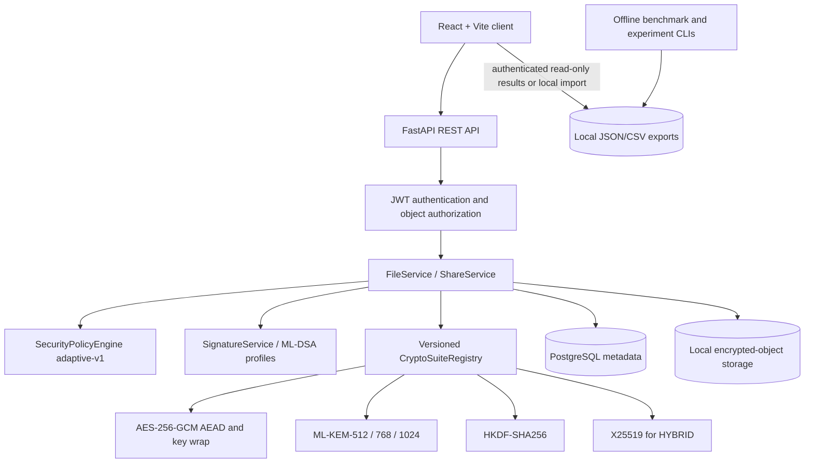
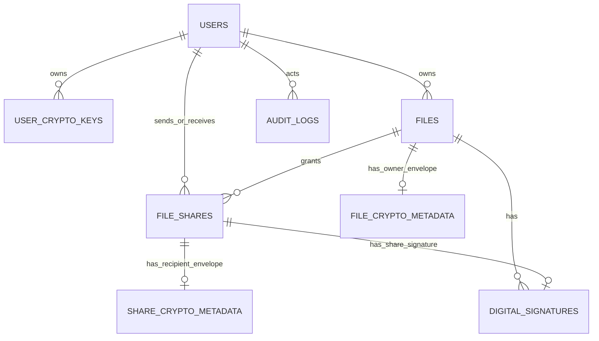

# QuantumShield — Adaptive Crypto-Agile Post-Quantum Secure File Sharing System

## Abstract

Conventional secure file sharing often uses classical public-key mechanisms whose long-term confidentiality may be threatened by future quantum-capable adversaries. QuantumShield is a research-oriented, server-mediated file-sharing application that encrypts each file once with AES-256-GCM, uses ML-KEM to establish recipient-specific key-encryption keys, optionally combines X25519 and ML-KEM for hybrid key establishment, and signs file/share packages with ML-DSA. A deterministic, explainable policy selects among three approved ML-KEM parameter sets; a versioned crypto-suite registry prevents silent algorithm fallback. Controlled synthetic benchmarks and security regressions evaluated the implementation. In the completed 24-scenario standard paired experiment, Adaptive selected LOW/STANDARD/HIGH in 6/6/12 scenarios, met every configured policy minimum, and measured 38.565 ms versus 39.931 ms equal-scenario-weight mean crypto time for Fixed HIGH (3.422% observed saving) and 545,514 versus 568,234 aggregate metadata bytes (3.998% saving). These measurements are machine- and workload-specific, not production HTTP latency or a general security ranking. The backend remains trusted; no zero-knowledge, malware-scanning, formal-proof, or production-deployment assurance is claimed.

## 1. Introduction, problem, and motivation

File sharing needs confidentiality, authenticity, access control, manageable key custody, and usable performance. A future cryptographically relevant quantum computer could weaken widely used RSA/ECC public-key assumptions for data recorded today. Replacing a single algorithm does not solve migration, recipient management, authorization, revocation, or the overhead of stronger parameter sets. QuantumShield studies the *system integration* problem: a modular application using standardized cryptographic roles, explicit versions, recipient-specific envelopes, an explainable selection policy, and measured rather than assumed performance.

The work does **not** invent AES, ML-KEM, X25519, HKDF, or ML-DSA. Its contribution is an integrated, testable architecture and a paired evaluation of its deterministic policy against an always-HIGH baseline. It is a college-project/research prototype rather than an independently audited production service.

## 2. Objectives, research questions, and scope

The implemented objectives are authenticated AES-256-GCM file storage; ML-KEM-512/768/1024 owner and recipient envelopes; optional X25519 + ML-KEM hybrid envelopes; HKDF-SHA256 derivation; ML-DSA file/share signatures; explainable MANUAL/RECOMMEND/AUTO selection; exact suite/version dispatch; owner and recipient authorization; future-access share revocation; offline benchmarking; paired adaptive comparison; and controlled attack tests.

The research questions are: (RQ1) what measured envelope cost and metadata size accompany the supported KEM parameter sets; (RQ2) what additional cost accompanies hybrid key establishment; (RQ3) whether the configured adaptive policy reduces measured overhead relative to Fixed HIGH while satisfying its own minimums; and (RQ4) how file-size and recipient-count workloads affect the synthetic pipeline. Phase 13 measures RQ1/RQ2/RQ4; Phase 14 directly evaluates RQ3. Neither study measures a production network/database deployment.

Scope includes registered users, local encrypted-object storage, server-managed private keys, owner upload/download, recipient sharing, signatures, revocation, and local research exports. Exclusions include client-held zero-knowledge keys, malware/content scanning, blockchain, cloud deployment, automatic key rotation, retroactive erasure of downloaded plaintext, and new cryptographic primitives.

### Conceptual comparison

| Dimension | A basic conventional design may use | QuantumShield implements |
| --- | --- | --- |
| Bulk file protection | A symmetric cipher | AES-256-GCM with a fresh per-file key |
| Key establishment | RSA or ECC | ML-KEM; optional X25519 + ML-KEM |
| Parameter choice | One fixed configuration | Three allow-listed levels selected manually or by deterministic rules |
| Migration | Deployment-specific | Explicit suite IDs and historical format dispatch |
| Sender authenticity | Deployment-specific | ML-DSA FILE and SHARE signatures |
| Multi-recipient delivery | Potentially separate copies or envelopes | One ciphertext plus independent recipient key envelopes |

This is a comparison with a *possible basic design*, not a claim that all conventional products lack these controls or are insecure today.

## 3. Implemented system architecture



The application is a modular monolith. Routes validate HTTP inputs and map safe errors; services enforce ownership/lifecycle and orchestrate work; repositories use SQLAlchemy; provider registries contain the concrete cryptography. The browser has presentation duties, not authority to select arbitrary algorithms or bypass verification. PostgreSQL is the deployment target; isolated tests use SQLite. The local storage adapter holds opaque ciphertext objects, not plaintext. Benchmark/experiment runs are offline CLIs, with no remotely triggerable run endpoint or benchmark table.

## 4. Cryptographic architecture and key management

For every new upload, the backend makes a fresh random 256-bit AES file key and 96-bit nonce and encrypts the complete file with AES-256-GCM. An owner envelope protects the same file key. A new share creates an independent recipient envelope; the file ciphertext is *not* encrypted again. Each envelope records an exact key ID/version, suite/version, KEM ciphertext, fresh HKDF salt, wrapping nonce, and AES-GCM-wrapped file key. The backend verifies stored signatures before recovering the key and authenticates AES-GCM before returning plaintext. The retained plaintext SHA-256 is an exact-output check, not a substitute for AEAD authentication.

```text
Plaintext -- fresh AES-256 key + AES-256-GCM --> one ciphertext
                             |
                             +--> owner ML-KEM/hybrid envelope
                             +--> Bob's fresh ML-KEM/hybrid envelope
                             +--> Charlie's fresh ML-KEM/hybrid envelope
```

`PQ_ONLY` uses ML-KEM encapsulation to produce a transient shared secret, HKDF-SHA256 to derive a 32-byte KEK, and AES-256-GCM to wrap the file key. `HYBRID` adds a fresh ephemeral X25519 agreement secret; the project-specific length-delimited combiner feeds *both* the PQ and classical secrets into suite/context-bound HKDF. It is neither double content encryption nor the TLS `X25519MLKEM768` protocol. Failure of either component prevents successful authenticated unwrap; there is no PQ-only fallback. Hybrid resistance is conditional on the assumptions and implementation of its components and composition.

Registration provisions one active key for each ML-KEM set, X25519, and ML-DSA-65. User private material is AES-256-GCM-protected under the configured 32-byte application master key, with record-bound associated data. Public keys and encrypted private blobs are persisted; raw ML-KEM shared secrets, X25519 shared secrets, derived KEKs, ephemeral X25519 private keys, and raw file AES keys are not persisted. Historical envelopes reference exact key versions. There is no automatic key/master-key rotation, escrow, KMS, or HSM. Losing the master key can make existing files unrecoverable; compromising it with database/storage access is severe. Python cannot guarantee in-memory zeroization. See [key management](KEY_MANAGEMENT.md) and [cryptographic design](CRYPTOGRAPHY_DESIGN.md).

### Approved confidentiality suites

| Architecture | LOW | STANDARD | HIGH |
| --- | --- | --- | --- |
| `PQ_ONLY` | `QS-PQ-512-V1` | `QS-PQ-768-V1` | `QS-PQ-1024-V1` |
| `HYBRID` | `QS-HYBRID-512-V1` | `QS-HYBRID-768-V1` | `QS-HYBRID-1024-V1` |

All six use AES-256-GCM, HKDF-SHA256, and authenticated AES-GCM key wrapping. LOW/STANDARD/HIGH map to ML-KEM-512/768/1024 respectively; hybrid additionally uses X25519. The suite registry validates every stored identifier, level, architecture, algorithm, and version. ACTIVE may protect new data; DEPRECATED may recover historical data; DISABLED is rejected. Unknown or contradictory metadata fails without guessing. Version-1 Phase 4 master-wrapped files, version-2 ML-KEM files, version-3 suite-bound PQ files, and version-4 hybrid files have explicit dispatch. Historical unsigned records remain explicitly recognizable; *new* missing signatures fail. See [crypto agility](CRYPTO_AGILITY.md) and [hybrid construction](HYBRID_CRYPTO.md).

## 5. Adaptive selection, signatures, and revocation

The `adaptive-v1` policy uses supplied sensitivity, document category, and a small set of secret-bearing filename extensions. Each applicable rule contributes a minimum; the strongest of LOW < STANDARD < HIGH wins. An unclassified request defaults to STANDARD. `MANUAL` records the explicit selection, `RECOMMEND` requires confirmation at or above its minimum, and `AUTO` chooses without accepting a conflicting explicit level. It is deterministic rule-based logic—not machine learning or content inspection. Mislabelled metadata can yield an unsuitable selection; these minimums are project policy, not universal classification standards. The final upload recomputes rather than trusting a preview. See [adaptive security](ADAPTIVE_SECURITY.md).

ML-DSA signs canonical FILE and SHARE payloads containing the actual ciphertext digest, exact signing key/version, cryptographic package digest, sender identity, and relevant file/share/policy metadata. SHARE signatures bind recipient and share identity. Signing is independent of confidentiality suites; ML-DSA does **not** encrypt the file. An invalid required signature blocks a trusted download before key recovery. Because the trusted server owns signing keys, the feature provides application-level sender authenticity, not client-held non-repudiation. See [digital signatures](DIGITAL_SIGNATURES.md).

An ACTIVE share grants its intended recipient future application retrieval. Revocation atomically changes the grant to REVOKED, disables its recipient envelope, and records a secret-free audit event. A download checks lifecycle and audit state before cryptography. Re-sharing creates a new grant, envelope, and signature. **Revocation cannot erase plaintext, keys, or ciphertext already copied by an authorized recipient.** A privileged database rollback that removes all revocation evidence remains an operational risk. See [access revocation](ACCESS_REVOCATION.md).

## 6. Technology stack, database, and API

The frontend is React 19 with Vite 8, React Router, and CSS/data-table bars rather than a chart library. The backend uses Python 3.13, FastAPI, SQLAlchemy, Alembic, PostgreSQL via psycopg, Argon2id via pwdlib, HS256 JWT via PyJWT, `cryptography` 50.0.2 (AES-GCM, X25519, ML-KEM-768/1024, ML-DSA), and `mlkem` 0.1.0 for ML-KEM-512. Tests use pytest and in-memory SQLite. Version pins are in the manifests; the 512 dependency remains a beta/research limitation.

The actual relational entities are `users`, `user_crypto_keys`, `files`, `file_crypto_metadata` (owner envelope), `file_shares`, `share_crypto_metadata` (recipient envelope), `digital_signatures`, and `audit_logs`. There is **no** `file_key_envelopes` or benchmark-results database table; those names in older design sketches were proposals. Files carry opaque storage keys, policy decision fields, SHA-256 and a `signature_required` flag; shares carry authorization state; signature rows bind a file or share; audit events retain lifecycle evidence. The [database design](DATABASE_DESIGN.md) distinguishes the final schema from historical proposals.



Important REST groups under `/api` are registration/login (`/auth`), current user/search (`/users`), key/suite discovery (`/crypto`), policy options/recommendation (`/security`), owner upload/list/detail/download/verify/delete/share (`/files`), sent/received/detail/download/verify/revoke (`/shares`), owner-scoped dashboard (`/dashboard`), and authenticated read-only latest research exports (`/research`). Liveness is `/api/health`, readiness/capabilities `/api/system/status`, and Swagger `/docs`. All resource IDs are UUIDs but object-level authorization—not obscurity—is decisive. The [API design](API_DESIGN.md) contains historical proposal sections; generated OpenAPI is the executable contract.

## 7. Implementation phases and user workflow

| Phases | Delivered capability |
| --- | --- |
| 0–3 | Requirements/threat design; React/FastAPI/PostgreSQL foundation; authentication; owner-only bounded files |
| 4–6 | AES-GCM encrypted objects; ML-KEM owner envelopes; recipient-specific sharing |
| 7–9 | Three ML-KEM levels; deterministic policy; provider/suite registry and historical dispatch |
| 10–12 | Optional hybrid X25519 + ML-KEM; ML-DSA package signatures; share revocation/audit |
| 13–15 | Offline benchmarks; paired Adaptive/Fixed-HIGH experiment; owner-scoped dashboard/research UI |
| 16–17 | Controlled attack regressions/fixes; verified final documentation and demonstration package |

In the normal workflow Alice registers and the backend provisions five protected identity keys. She uploads a file with a selected architecture and mode; AES encrypts it once, the chosen owner envelope protects its file key, and ML-DSA signs the package. Alice creates a Bob-specific share; Bob sees only authorized metadata, verifies signatures, and downloads only after recipient key recovery and AES authentication. Alice may later revoke Bob's *future platform access*. The dashboard shows owner-scoped counts/distributions, key readiness, recent relevant audit events and decisions; file/share pages show verification state. The research page reads completed synthetic exports or imports local JSON; it never runs benchmarks remotely. See [dashboard details](UI_DASHBOARD.md) and the [demo script](DEMO_SCRIPT.md).

## 8. Phase 13 benchmark methodology and measured results

The complete source is standard run `c46c0376-20c0-412b-af4b-7af6ae3dffe6` in `backend/benchmark_results/<run_id>/results.json`; [generated measured tables](RESULTS_SUMMARY.md) derive directly from it. The source reports Windows 11, an Intel64 Family 6 Model 154 CPU, Python 3.13.2, `cryptography` 50.0.2, and `mlkem` 0.1.0. Each operation had 5 warmups and 20 measured iterations using `time.perf_counter_ns`; no samples were dropped. File sizes were 1 KB, 100 KB, 1 MB, 10 MB, and 25 MB; recipient counts were 1, 5, and 10. The harness measures primitive, envelope-suite, file AES, share, and synthetic local-transfer work, with mean/median/SD/min/max/p95. `tracemalloc` gives peak Python allocation in a separate untimed pass, not total RSS or native-library memory. AES correctness, recipient envelope recovery, signatures, and file hash were checked.

For the **recipient-envelope `protect_and_recover` operation**, measured mean times were 0.234 ms for the benchmark-only X25519 baseline; 0.357/1.063/1.482 ms for PQ-512/768/1024; and 1.140/1.848/2.240 ms for HYBRID-512/768/1024. Corresponding measured envelope metadata sizes were 124; 860/1,180/1,660; and 892/1,212/1,692 bytes. These are not full application request latencies or a security ranking. X25519-only is classical and not an application suite. The full primitive table (including measured keygen, encapsulation, decapsulation, public-key and KEM-ciphertext sizes), suite mean/median/p95/allocation table, and AES-by-file-size table are generated in [RESULTS_SUMMARY.md](RESULTS_SUMMARY.md); raw samples stay in the source export. The frontend research charts show actual local results with labeled units, not invented examples.

## 9. Phase 14 Adaptive versus Fixed HIGH

The primary question is whether `adaptive-v1` can reduce measured crypto/metadata overhead against always using HIGH while satisfying its configured minimums. The complete standard run is `bcec2f67-2984-4e01-8c4d-004ba5c92981` in `backend/benchmark_results/adaptive/<run_id>/adaptive_vs_fixed.json`; its required Phase 13 reference is the run above, but reference timings were not pooled. It has 12 base scenarios in both PQ_ONLY and HYBRID tracks: 24 scenarios × 30 measured pairs, after 5 warmups per scenario. Synthetic content, scenario metadata, recipient contexts, signing identity, and implementation are paired; execution order alternates. Savings are `(Fixed HIGH − Adaptive) / Fixed HIGH × 100`, retaining negative results. The aggregate gives equal weight to each scenario. Descriptive normal-approximation 95% intervals are not formal significance tests.

| Group | Scenarios | Adaptive mean crypto | Fixed-HIGH mean crypto | Observed time saving | Metadata saving |
| --- | ---: | ---: | ---: | ---: | ---: |
| Overall | 24 | 38.565 ms | 39.931 ms | 3.422% | 3.998% |
| PQ_ONLY | 12 | 36.800 ms | 37.755 ms | 2.528% | 4.009% |
| HYBRID | 12 | 40.329 ms | 42.107 ms | 4.223% | 3.987% |
| Adaptive LOW | 6 | 14.027 ms | 16.105 ms | 12.899% | 12.484% |
| Adaptive STANDARD | 6 | 37.839 ms | 40.299 ms | 6.105% | 8.254% |
| Adaptive HIGH | 12 | 51.196 ms | 51.660 ms | 0.899% | 0.000% |

Adaptive selected LOW/STANDARD/HIGH in 6/6/12 scenarios and met all defined policy minimums. Total scenario metadata was 545,514 versus 568,234 bytes. The hypothesis is **partially supported**: lower permitted levels reduced metadata and yielded modest observed mean crypto savings in this scenario mix, while HIGH cases used identical suites and had no designed metadata benefit. Their ~0.9% timing difference is noise. Some individual cases had negative time savings. The 25 MB cases occurred only at HIGH, so size-group differences cannot establish a causal file-size effect; recipient-count and label mixes also confound simple comparisons. Results are specific to one machine, providers, Python runtime, and synthetic workload. See [adaptive methodology](ADAPTIVE_EVALUATION.md) and the [generated aggregate table](RESULTS_SUMMARY.md).

## 10. Phase 16 security evaluation

The dedicated `backend/tests/security/` suite exercised invalid/forged JWTs, user/file/share IDOR, broad searches, pagination, traversal filenames, oversized/empty uploads, AES-GCM tampering, wrong ML-KEM and X25519 keys, hybrid component/package swaps, ML-DSA signature and metadata corruption, unknown/mismatched suites, policy downgrade attempts, revocation/re-share isolation, missing objects/metadata, failure cleanup, secret logging, and safe errors. **88 Phase 16 tests passed**; the full backend suite passed **267 tests** at final verification. Frontend lint/build passed. The tests use isolated SQLite and temporary storage, not production data. The complete matrix, exact test names, methodology, and caveats are in [SECURITY_TESTING.md](SECURITY_TESTING.md).

The Phase 17 disposable `scripts/check_final_demo.py` API rehearsal passed an Alice/Bob AUTO+HYBRID confidential upload (HIGH/`QS-HYBRID-1024-V1`), FILE/SHARE signature checks, Bob's SHA-256-matching download, cross-user denial, owner dashboard counts, both authenticated research-export routes, and post-revocation denial. The full local browser rehearsal also passed: Alice previewed and uploaded the synthetic `DEMO_FIXTURE.txt` with AUTO/HYBRID and CONFIDENTIAL/GENERAL labels, saw a verified FILE signature, shared with Bob, and Bob saw a verified SHARE signature and downloaded matching bytes. Alice revoked the grant; Bob then saw revoked access with a disabled download control, and a direct authenticated download returned 403. Login/registration, dashboard, both named standard research runs, and Security with five ready keys/six suites rendered successfully. These checks used disposable SQLite; Alembic/PostgreSQL were not exercised. See [FINAL_VERIFICATION.md](FINAL_VERIFICATION.md) for the exact fixture hash, commands, and residual setup work.

| Tested attack | Observed control | Result |
| --- | --- | --- |
| Malformed/forged JWT | MAC/claim validation | PASS |
| Cross-user file/share ID | Owner/recipient scoping | PASS |
| Ciphertext/nonce/wrapped-key change | Signature and/or AES-GCM authentication | PASS |
| Wrong ML-KEM or one hybrid component | Bound key recovery and authenticated unwrap | PASS |
| Signed metadata/signature change | ML-DSA verification before trusted download | PASS |
| Unknown/mismatched suite | Registry and metadata rejection; no fallback | PASS |
| Revoked share reuse | Lifecycle/audit denial before cryptography | PASS |

Two **low-severity** robustness defects were found and fixed: a signed file with missing crypto metadata was misreported as legacy plaintext, and a corrupted internal storage key returned a generic 500. Neither released plaintext. An **informational** frontend clarity issue (session-expiry and invalid-signature messaging) was also improved. Each has a regression or verification note in the security report. These results do not imply that the system is vulnerability-free.

## 11. Threats, guarantees, and limitations

Against a storage-only attacker, AES-GCM and key separation protect stored plaintext if keys/backend remain uncompromised; ciphertext deletion and access-pattern leakage remain. Against an unauthorized registered user, object-level predicates prevent other-user retrieval in tested cases; a stolen valid token remains usable until expiry. Against metadata/ciphertext tampering, signed packages and authenticated encryption fail closed in tested paths; full database rollback, signer-key compromise, and operational insider actions remain. A quantum-capable attacker motivates ML-KEM, but provider defects, endpoints, and symmetric-key/security assumptions still matter. TLS is required for network use and is not supplied by the development server.

Most importantly, the backend holds and can recover private keys and plaintext, so this is **not zero-knowledge or client-held end-to-end encryption**. The application master key is a major trust anchor. A malicious authorized recipient can copy content; revocation only stops later platform downloads. Metadata/share relationships are not fully hidden; user classification may be wrong. There is no malware scan, semantic content inspection, MFA, online rate limiting, JWT denylist, formal proof of the custom composition, independent cryptographic audit, PostgreSQL race/load study, or large-scale production deployment validation. Browser upload parsing may transiently spool plaintext. The ML-KEM-512 package's beta status and Windows/provider complexity need reassessment before deployment. See [threat model](THREAT_MODEL.md) and [security model](SECURITY_MODEL.md).

## 12. Conclusion and realistic future work

QuantumShield demonstrates a working server-mediated secure-sharing architecture with one authenticated encrypted object, post-quantum or hybrid recipient-specific key establishment, explainable deterministic selection, versioned cryptographic suites, sender signatures, future-access revocation, offline performance evidence, and threat-driven regressions. In this one synthetic dataset, the adaptive policy met its own minimums and produced modest measured resource savings; it did not establish universal superiority or stronger security at lower levels. Crypto-agility matters because formats and algorithms can be explicitly versioned and migrated without silent fallback, while adaptive selection allows transparent performance/security-policy tradeoffs where the policy permits them.

Future work should prioritize client-held or hardware-backed key custody, managed master-key rotation/recovery, independent review/formal protocol analysis of the hybrid composition, real PostgreSQL concurrency and deployment testing, TLS/abuse controls, content-aware classification, cloud storage adapters, multi-device key management, and a larger controlled performance study. HQC or another KEM would require a new reviewed provider/suite and migration plan—not a runtime fallback.

## 13. Reproducibility, submission, and references

Use [SUBMISSION_CHECKLIST.md](SUBMISSION_CHECKLIST.md) to assemble a secret-free handoff and distinguish generated aggregate tables from separately retained raw synthetic exports.

Windows setup, PostgreSQL/Alembic instructions, and diagnostics are in [SETUP.md](SETUP.md); exact test/benchmark/experiment commands and artifact paths are in [REPRODUCIBILITY.md](REPRODUCIBILITY.md) and [COMMANDS.md](COMMANDS.md). The [demo script](DEMO_SCRIPT.md), [project summary](PROJECT_SUMMARY.md), [viva questions](VIVA_QUESTIONS.md), and [checklist](DEMO_CHECKLIST.md) support presentation. Raw local benchmark exports are ignored by Git and must be retained separately for audit; the generated aggregate [RESULTS_SUMMARY.md](RESULTS_SUMMARY.md) is submission-safe and traceable to the run IDs. Do not submit `.env`, passwords, tokens, master keys, private-key material, or user files. Related-work papers have not been systematically reviewed and must be verified before any publication claim.

Official standards and primary references: [NIST FIPS 203, Module-Lattice-Based Key-Encapsulation Mechanism Standard](https://csrc.nist.gov/pubs/fips/203/final); [NIST FIPS 204, Module-Lattice-Based Digital Signature Standard](https://csrc.nist.gov/pubs/fips/204/final); [NIST SP 800-38D, GCM/GMAC](https://csrc.nist.gov/pubs/sp/800/38/d/final); [RFC 5869, HKDF](https://www.rfc-editor.org/info/rfc5869/); [RFC 7748, X25519](https://www.rfc-editor.org/info/rfc7748/). Implementation/library specifications: [Python `cryptography` documentation](https://cryptography.io/en/latest/), [FastAPI documentation](https://fastapi.tiangolo.com/), and [PostgreSQL documentation](https://www.postgresql.org/docs/). These standards define the underlying algorithms; they do not certify this application's composition or deployment.
