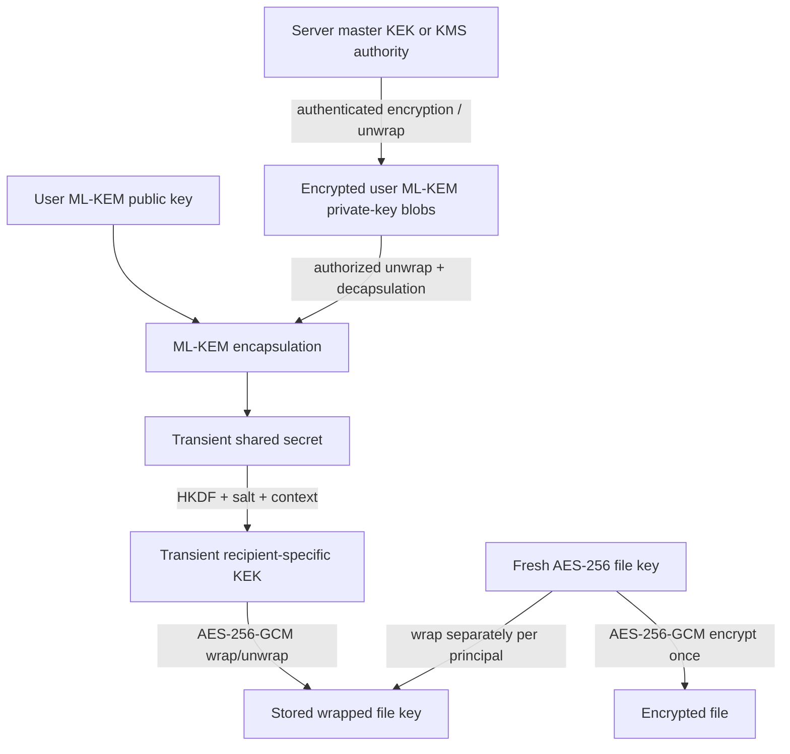

# Key Management

## Phase 12 recipient grant invalidation

Revocation marks a recipient's share envelope inactive and blocks future server-side key recovery through that share. It does not destroy the recipient's protected ML-KEM/X25519 identity keys, rewrite the owner's file key, or claim to erase previously obtained plaintext/key material. Re-sharing creates a fresh recipient envelope under the stored file suite. See [Access revocation](ACCESS_REVOCATION.md).

## Phase 11 signing identity custody

New registrations also receive a purpose-separated ML-DSA-65 signing key. The 32-byte private seed is encrypted by the existing master-key AES-256-GCM protection service; the public key is retained alongside an exact key ID/version. Signature records reference that historical key rather than the currently active key. Existing users can run `python scripts/provision_signing_keys.py` or idempotent `POST /api/crypto/keys/ensure`. `key_purpose` checks prevent confusing ML-DSA with ML-KEM or X25519. No identity-key rotation/revocation, KMS, or HSM is implemented; Phase 12 share-grant revocation is separate. See [Digital signatures](DIGITAL_SIGNATURES.md).

## Phase 10 X25519 custody

Registration and idempotent provisioning now ensure exactly one active X25519 key alongside the three ML-KEM keys. The 32-byte raw X25519 private key is protected by the existing master-key AES-256-GCM service; the 32-byte public key is stored in `user_crypto_keys`. Each hybrid owner/share wrap creates a fresh ephemeral sender X25519 keypair and stores only its public key. Both component shared secrets, combined input, and KEK are transient. Historical key IDs/versions remain usable; there is no rotation or automatic rewrap. See [Hybrid cryptography](HYBRID_CRYPTO.md). Sections labeled earlier phases below describe their historical behavior.

## Phase 9 suite compatibility

A recipient key is compatible only when its canonical KEM algorithm exactly matches the stored suite. The registry selects that provider; key lookup verifies the exact algorithm and key version. New suite-bound owner and share envelopes authenticate suite identity in derivation and wrapping contexts. Existing server-protected user keys are unchanged, and the migration does not regenerate or rewrap key material.

## Phase 7 current key hierarchy

Phase 7 extends the user-key hierarchy to all three supported parameter sets:

```text
Base64 environment value MASTER_KEY_BASE64
  -> exactly 32 decoded bytes (deployment master key)
  -> AES-256-GCM protects each user's algorithm-specific ML-KEM private material

Owner public key for the stored ML-KEM-512/768/1024 algorithm
  -> encapsulation establishes a transient 32-byte shared secret
  -> HKDF-SHA256 + fresh salt + versioned context derives a 32-byte KEK
  -> KEK AES-256-GCM wraps one independent random file key
  -> file key AES-256-GCM encrypts one stored file object
```

The application never generates a missing master key and never stores it in PostgreSQL, source control, object storage, API responses, or logs. Startup composition decodes it with strict Base64 validation and refuses invalid encoding or any decoded length other than 32 bytes using a redacted error. Development uses an untracked environment file; production should inject the value from a managed secret facility.

Every upload creates a new file key. The raw ML-KEM shared secret, derived KEK, private seed, and file key exist only transiently and are not persisted. Losing or changing the master key makes server-managed private seeds—and therefore version-2 file keys—unrecoverable. Compromise of that key plus database/storage permits backend-equivalent recovery.

User records have immutable key IDs and positive key versions, but Phase 7 does not perform rotation. The system has no master-key identifier, automated rewrap, KMS/HSM integration, recovery escrow, or split knowledge. Back up the master secret securely. Python cannot guarantee zeroization of immutable buffers.

Phase 4 version-1 files retain their direct master-key unwrap path. Phase 6 introduced recipient sharing with separate share envelopes. Phase 7 adds per-user three-algorithm keysets and exact algorithm selection; rotation remains a later target.

### Phase 7 keyset provisioning

Registration transactionally creates one active version-1 key for each supported algorithm. `POST /api/crypto/keys/ensure` and `python scripts/provision_mlkem_keys.py` are idempotent: they create only missing active algorithm keys and never replace a valid key as a side effect. The provisioning script reports counts only and never emits public or private key bytes.

An upload resolves the owner's active key for the selected security level. A share resolves the recipient's active key for the file's already-stored algorithm. Missing exact keys cause a safe failure; neither operation substitutes a weaker algorithm. Historical envelopes retain their exact key ID/version so later defaults cannot change how they are decrypted.

The ML-KEM-512 provider currently stores the parameter set's 1,632-byte private material before AES-GCM protection. The `cryptography` providers store 64-byte seeds for ML-KEM-768 and ML-KEM-1024. Database constraints validate the algorithm-specific public/private sizes.

## 1. Goals

The key-management design separates long-lived user key pairs, transient KEM secrets, per-file symmetric keys, derived wrapping keys, server custody keys, public nonces, and wrapped key material. It aims to minimize secret lifetime and blast radius while admitting that reliable memory erasure is not guaranteed in Python or a managed runtime.

## 2. Key hierarchy



The master KEK is operational key custody, not derived from a user's password in the initial design. PostgreSQL must not contain both the master KEK and the encrypted private-key blobs in recoverable form.

## 3. Lifecycle by material

| Material | Creation | Runtime location | Persisted form/location | Scope/lifetime | Disposal/rotation |
| --- | --- | --- | --- | --- | --- |
| ML-KEM public key | With user key pair | Backend memory during key/share operations | Raw public bytes plus algorithm, version, fingerprint, status in DB | Per user key version; reusable for multiple envelopes | Old records retained while referenced; new shares use active version |
| ML-KEM private key | With user key pair | Transient backend memory after authorized unwrap | Authenticated-encrypted blob in DB or external KMS/HSM reference; never plaintext | Per user key version; long-lived | Best-effort zeroize transient buffer; rotate by creating new version; delete only when no envelopes/reference/recovery duty remains |
| Server master KEK / KMS key | Provisioned outside app | KMS/HSM or tightly controlled process memory | Secret manager/KMS, never DB/source/logs | Deployment-level, versioned | Rotation rewraps private-key blobs without changing ML-KEM key pairs; keep old KEK until migration verified |
| AES file key | CSPRNG at upload | Backend crypto buffer | Never raw; stored only once per authorized principal as independently wrapped envelope data | Unique per encrypted file generation | Best-effort erase after encrypt/wrap; file-key rotation requires file re-encryption and envelope recreation |
| ML-KEM shared secret | Encapsulation/decapsulation | Crypto provider/backend memory | Never stored | New per encapsulation/envelope operation | Consume into KDF and best-effort erase immediately |
| Derived KEK | HKDF from shared secret, salt, context | Backend memory | Never stored | One envelope/purpose; 256 bits | Use only for envelope AEAD, then best-effort erase |
| Wrapped AES key | AES-GCM under derived KEK | Backend/database | Ciphertext + authentication tag in `FileKeyEnvelope` | One per file/principal/key version | Disable/delete with envelope subject to retention; copying it alone is insufficient without private key |
| File AES-GCM nonce | 96-bit CSPRNG | Backend | Non-secret file crypto metadata | Unique under its file key | Retain as long as ciphertext; never change independently |
| Envelope wrapping nonce | 96-bit CSPRNG | Backend | Non-secret envelope metadata | Unique under its derived KEK | Retain as long as wrapped key; never change independently |
| HKDF salt | CSPRNG (non-secret) | Backend | Envelope metadata | One envelope | Retain with envelope |
| AES-GCM authentication tag | AEAD output | Backend | Stored with ciphertext/container or explicit versioned field | One encryption invocation | Retain and verify; never truncate below selected approved profile |
| JWT signing key | Provisioned outside app | Auth service/KMS | Secret manager; public verification key may be published if asymmetric | Deployment/version | Rotate with key ID and bounded overlap |
| Password-hash salt | Generated by password library | Auth service | Encoded with password hash | Per password | Replaced on password change/rehash |

## 4. User-key records and binding

Every user key record contains an immutable ID, owner user ID, exact algorithm, public key, public-key fingerprint, encrypted private-key blob or external reference, private-key protection version/key ID, created/activated/retired timestamps, and status. A key fingerprint is for identification; it is not independent proof of ownership.

The backend binds a newly generated key to the authenticated user. Imported public keys, if ever supported, require proof-of-possession or a carefully defined trust ceremony before others may rely on them. Normal users may manage only their own key lifecycle.

Private-key blob encryption uses a maintained AEAD and canonical AAD containing at least a domain label, user ID, key record ID, algorithm, and protection version. Swapping encrypted blobs between records must fail authentication.

## 5. Envelope derivation

For recipient envelope `E`:

```text
(kem_ciphertext, shared_secret) = KEM.Encapsulate(recipient_public_key)
salt = CSPRNG(salt_length)
context = CanonicalEncode(versioned envelope identity and algorithms)
KEK = HKDF-SHA-256(shared_secret, salt, context, 32 bytes)
wrap_nonce = CSPRNG(12 bytes)
wrapped_file_key = AES-256-GCM.Encrypt(KEK, wrap_nonce, file_key, context)
```

For recovery, decapsulation plus the stored salt and identical context derive the same KEK; successful AEAD authentication of `wrapped_file_key` confirms the context/key combination before the file key is used. The implementation must follow the chosen libraries' exact byte-oriented contracts and FIPS 203 validation behavior.

## 6. Rotation rules

### User ML-KEM key rotation

1. Create a new key version and validate it.
2. Atomically mark it active for new envelopes; retire (do not immediately delete) the previous version.
3. Existing envelopes continue to reference the old version.
4. Optionally migrate each active envelope by recovering the file key and creating a new envelope under the new public key.
5. Destroy the old private key only after references, retention, backup, rollback, and recovery requirements are resolved.

### Server master-KEK rotation

Rewrap the encrypted user private-key blobs from old protection-key ID to new protection-key ID through a resumable, audited process. Do not regenerate user key pairs or file envelopes. Verify each rewrap before retiring the old KEK.

### File-key rotation

Generate a new file key and nonce, decrypt/authenticate the old object, re-encrypt as a new immutable generation, and recreate envelopes for all currently authorized principals. Atomically switch the active generation after verification. This expensive process is not required for ordinary share revocation and cannot retract an old generation already copied with its key.

## 7. Deletion and retention

- Revoking a share makes its envelope unavailable through application paths and records when/by whom; physical deletion may follow retention policy.
- Deleting a file uses a recoverable state transition, removes active grants/envelopes according to retention, then deletes the object idempotently.
- A user key version cannot be physically deleted while a recoverable active/historical envelope depends on it unless those envelopes are migrated or deliberately rendered unrecoverable.
- Backups containing encrypted private keys, envelopes, and ciphertext need access control, retention expiry, restore testing, and cryptographic erasure planning through master-key lifecycle.
- Audit retention must not retain secrets that should never have been logged.

## 8. Randomness and nonce policy

All production keys, salts, nonces, and secret token material use the operating-system CSPRNG through maintained libraries. No timestamps, counters without a rigorously enforced per-key scheme, default PRNGs, usernames, file IDs, hashes of files, or user passwords are key material.

With a fresh random file key for every encrypted file generation and one file encryption per key, a random 96-bit GCM nonce is simple and low risk. Envelope KEKs are independently derived per encapsulation and still use a fresh 96-bit wrapping nonce. Tests may inject deterministic bytes only through a test-only dependency that cannot be enabled in production.

## 9. Memory-handling reality

Keep secrets in byte buffers for the minimum duration, avoid string conversion and copies, scope operations narrowly, and use library secure-memory/zeroization facilities where available. However, Python garbage collection, immutable `bytes`, copies inside libraries, swapping, crash dumps, and virtualized hosts prevent a guarantee of complete erasure. Documentation and risk claims must say **best-effort memory minimization**, not guaranteed zeroization.

## 10. Recovery trade-off

Server-managed custody allows service recovery if database ciphertext, object storage, and the correct master-key versions are backed up. Loss of the master KEK or user private-key material can permanently make envelopes unrecoverable. Conversely, backing them up expands the compromise surface. Phase 1 must document development secret storage; production design later must define separated encrypted backups, recovery roles, rotation, and disaster-recovery tests.

## 11. Prohibited practices

- Store plaintext private keys, file keys, shared secrets, or derived KEKs.
- Derive a file key directly from a password.
- Reuse a file key across unrelated files or generations.
- Use the ML-KEM shared secret directly for multiple unlabeled purposes.
- Swap algorithm/version defaults when decoding old records.
- Delete old key versions while valid envelopes still depend on them without an explicit destructive policy.
- Export secrets in API responses, metrics, logs, fixtures, screenshots, or benchmark data.

## 12. Phase 6 share-key lifecycle

For a new share, the backend briefly recovers the existing file key through the owner's recorded envelope, encapsulates to the recipient's active public key, derives a recipient-specific KEK, wraps the same file key, commits the share/envelope rows atomically, and releases its application references. The encrypted file is neither read nor rewritten. For download, the backend loads the exact recorded recipient key ID—even if a different key later becomes active—unprotects that private seed with the master key, and opens only that recipient envelope.

There is no identity-key rotation or revocation endpoint. Phase 12 can revoke a share grant, but old shares remain tied to their historical identity-key records while those encrypted private keys remain available. Owner deletion removes live share metadata and ciphertext, but cannot retract plaintext already delivered. Server-managed custody means the backend/master-key authority remains trusted and the product is not zero-knowledge. Python cannot guarantee zeroization of immutable key buffers.

